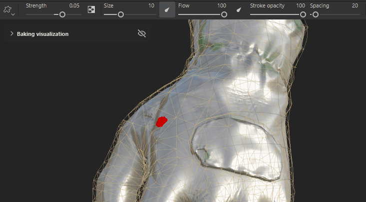

# Cage painting

**Cage painting** lets you paint areas to push the baking cage farther away or bring it closer to the low-poly surface. Cage painting helps prevent artifacts during baking while still capturing all the high-poly details of your mesh.

*The left glove, baked with a Distance-based cage and a low Max frontal distance, shows baking artifacts including distortion and areas where the cage intersects the high-poly mesh, losing detail. The right glove was baked using the same settings, but with cage painting to control the cage size.*

>[!NOTE]
>
> Cage painting automatically subdivides the cage mesh, which means that even with low resolution meshes, the cage can be pushed and pulled enough to cover all the details.

## Set up Cage painting

For **Cage painting** to be available, the project must have at least one High-poly scene file to bake from, and the Cage type must be set to **Distance-based**.

>[!NOTE]
>
> Support for **Cage painting** will be added for the **Automatic Cage type** in a future release.

We recommend setting the **Max frontal distance** and **Relative to bounding box** values before starting to paint your cage, as changing these values after painting may require touchups or even repainting the cage from scratch.

>[!TIP]
>
> If you want to start cage painting again from scratch, reset the cage painting parameters, cage painting strokes, or all baking settings.
>
> 

## Start Cage painting

To start Cage painting:

1. Switch to [**Baking mode**](baking.md).
1. Ensure that you have selected at least one **High-poly scene** file to bake from.
1. In the **Common settings** **panel**, navigate to the **Cage section**.
1. Set the **Cage type** to **Distance-based**.
1. Click **Paint cage**.

>[!VIDEO](https://video.tv.adobe.com/v/3504611?learn=on)

*This video shows a new project being set up for cage painting. First we switch to baking mode, then select a high-poly scene. The Distance-based Cage type is selected by default, so we’re able to start cage painting immediately.*

>[!NOTE]
>
> By default, **Auto-rebake** is turned on for the normal channel when you first enter **Cage painting**. This means that the normal map is automatically rebaked each time you modify the cage. Turn **Auto-rebake** on or off in the [**Mesh map bakers panel**](../interface/baking-panels/mesh-map-bakers.md).
>
> 

Once you enter Cage painting mode, the default visualization in the **Viewport** shows:

* The cage around the mesh in transparent beige.
* Areas where the high poly intersects the cage in bright red.
* Cage painted areas in green (positive) and blue (negative) on the low-poly mesh surface.

While in Cage painting mode, use the [**Baking visualization menu**](baking-visualization-settings.md) in the **Viewport** to customize how each element is visualized.

>[!NOTE]
>
> The bright red visualization of high-poly intersections with the cage is an approximate preview and doesn’t exactly match the final bake results. In most cases, the visualization is quite accurate, but for low-poly meshes with long, thin polygons, it can be inaccurate. For these meshes, it’s better to use **Quick Bake** or **Auto-Rebake** to check the final result.

## Cage painting tools

When painting the cage, you can use many of the tools and shortcuts you're used to from **Painting mode**, including the **Paintbrush**, **Eraser** and **Polygon fill** tools.

* You can switch between **Paintbrush**, **Eraser**, and **Polygon fill** from the toolbar, or use the standard [keyboard shortcuts](../interface/settings/shortcuts.md) from Painting mode.
* While using the **Paintbrush** or **Eraser** tools, you can adjust the tool's size, flow, opacity, and spacing using the parameters at the top of the **Viewport**. You can also use the relevant [keyboard shortcuts](../interface/settings/shortcuts.md) where available.

### Paintbrush

Using the **Paintbrush** at full **Strength**, **Flow** and **Opacity** has a huge impact on the cage surface. We recommend setting a very low **Strength** value and using the Flow and Opacity parameters to control the strength of the brush.

*In this example, the first brush stroke is way too strong, even with a Strength value of 0.05. After decreasing the Strength, Flow, and Stroke opacity, we have much more control over the effect.*

### Eraser

The Eraser tool allows you to remove paint from the cage, effectively reverting erased areas to the default cage size.

### Polygon fill

In **Cage painting** **mode**, the **Polygon fill tool** has an additional feature, a **Strength slider** appears in the **Viewport** when making changes that you can use to adjust the value for the last set of selected polygons.

This feature is particularly useful for making per-element adjustments using **Mesh fill mode** in scenes with multiple separate meshes.

>[!NOTE]
>
> This feature re-performs the last operation (applying the polygon fill) with a different strength value. As a result, performing a different operation or changing tools causes the slider to disappear.

It is often be useful to apply the same cage painted value to multiple areas of the mesh. To do so:

1. Select the first set of polygons.
1. Use the **Cage strength** slider to adjust the strength of the effect.
1. Copy the **Cage strength** value from the temporary slider in the **Viewport**.
1. Paste the value into the **Strength** slider at the top of the **Viewport**.
1. Select subsequent sets of polygons to apply the same strength value.

The video below shows this workflow in action, using the **Polygon fill** **tool** with **Mesh fill** selected.

>[!VIDEO](https://video.tv.adobe.com/v/3504621?learn=on)

>[!NOTE]
>
> When following these steps, it may be helpful to select **Normal blend mode** so that the Polygon fill tool overwrites the existing painted values, rather than adding to them.

### Blend modes

By default, both the **Paintbrush** and **Polygon fill** tools default to the **Linear dodge (add) blend mode**, but you can also use the **Normal** and **Lighten (Max) blend modes**.

* **Linear dodge (add)**
  * Each stroke/stamp adds or subtracts the given strength value from the existing value.
  * This blend mode works similarly to 3D sculpting applications, where each stroke you paint adds to the mesh surface.
* **Normal**
  * Each stroke/stamp sets the value to the specified strength, overwriting the existing value.
  * This blend mode behaves like the default paintbrush in painting mode, allowing you to cover the existing surface with a different value.
* **Lighten (Max)**:
  * Each stroke/stamp chooses the maximum value between the strength and the existing value.
  * With this blend mode, the edges of the brush take longer to build on subsequent strokes, helping to create a more gradual transition.