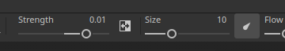

# Version 12.2

**Substance 3D Painter 12.2** brings an improved Polygon Fill tool with loop-based selection, cage painting for baking, Texture Set highlighting in the viewport, and order-independent transparency for real-time rendering.

Release date: **October 21, 2026**

## Major features

### Improved Polygon Fill

The **Polygon Fill** tool has been reworked with a new interface and new selection modes for polygon loops. The tool now also supports blending modes with an opacity control and can work on several channels at once. The selection handles occlusion too, which means polygons hidden from the camera are ignored.

* **Improved interface**

  The **Polygon Fill** settings in the **Properties** window have been reworked to be easier to use. The options are now displayed as rows of buttons, making switching between modes quicker. New tooltip icons describe how each mode works.

  

* **New selection modes**

  Two new modes dedicated to polygon loops have been added to the **Selection mode** row:

  

  * **Polygon loop fill**: this mode fills a complete loop of quads with a single click. Holding **Alt** while dragging also extends the selection in the opposite direction.

    

  * **Partial polygon loop fill**: this mode fills only a part of a loop, and dragging along the loop extends the selection. While dragging, arrows show the topology flow on each side of the selection to help anticipate unexpected path changes. A tooltip next to the cursor shows the number of polygons selected on both axes. Holding **Alt** while dragging also extends the selection in the opposite direction.

    

  Holding **Shift + A** also temporarily switches to **Polygon loop fill** from any selection mode. If the shortcut is released before the mouse button, the selection continues until the mouse button is released.

* **Fill mode switches the selection mode**

  The **Fill mode** options don't apply to **Polygon loop fill** and **Partial polygon loop fill** modes. For this reason, selecting a fill mode will automatically change the **Selection mode** back to the main one.

  

* **New Hit-test option**

  The new **Hit-test** option controls which polygons are included in the selection area. Discarding non-visible polygons is now the default behavior since the **Visible polygons only** option is enabled by default. Disabling this option restores the previous behavior of filling through the mesh.

  The available options are:

  * **Intersection**: (default) a polygon is filled if any part of it is inside the selection area or crosses its edge.
  * **Contained center**: a polygon is filled only if its center point lies inside the selection area.
  * **Visible polygons only**: if enabled, this option fills only the polygons visible from the current camera view. Occluded and back-facing geometry is therefore ignored.

  

* **Blending modes and opacity**

  The **Polygon Fill** tool now supports all blending modes, the same list as the one available in the layer stack. For example, **Linear dodge (Add)** adds values to the existing ones instead of replacing them. The modes are available in the new **Blending** section of the **Properties** window in addition to an **Opacity** slider. In **Material** mode, the blending mode applies to all channels enabled in the **Material** section.

  

* **Fill several channels at once**

  The **Polygon Fill** tool is no longer limited to a single channel. All channel properties enabled in the **Material** section can now be set and filled in one action.

  

* **Compatible with symmetry**

  **Polygon loop fill** and **Partial polygon loop fill** work with symmetry too. A single click works with mirror symmetry (radial symmetry might be less reliable however).

  

* **Resume previous stroke**

  The **Resume previous stroke** shortcut (keeping **A** pressed) now works with the **Polygon Fill** tool, including across blending modes and opacities.

  

* **Clearer feedback across Texture Sets**

  The wireframe is now displayed for the active Texture Set only and it updates when the selection changes. Hovering geometry from another Texture Set now shows a forbidden cursor to indicate the related geometry can't be filled.

  

>[!NOTE]
>
> For more information about the **Polygon Fill** tool, check out the [dedicated documentation page](https://experienceleague.adobe.com/en/docs/substance-3d-painter/using/painting/paint-tools/polygon-fill).

### New cage painting in Baking mode

The new **cage painting mode** is a per-pixel cage offset that can be painted on top of the global distance offset. This means the cage can now be adjusted by painting directly on the mesh. Areas where the high poly mesh goes outside the cage can then be fixed locally more easily.

* **New painting of the cage offset**

  A new **Paint cage** button in Baking mode now switches to the cage painting mode. In this mode the **Paint**, **Eraser**, and **Polygon Fill** tools can be used to adjust the cage distance from the low poly mesh.

  

  This is done by painting an intermediate texture. This texture is then used as an offset on the cage mesh during baking. This is similar to the **skew painting** process.

  A **Strength** parameter in the top toolbar sets the offset value applied by the stroke. The usual **Size**, **Flow**, **Stroke opacity**, and **Spacing** controls are also available, as well as an **Invert value** button. Symmetry is also supported.

  

  

* **Use Polygon Fill to select and fill whole mesh parts**

  The **Polygon Fill** tool can adjust the cage distance of partial or complete sub-objects at once. Clicking an element opens a floating toolbar with a **Cage Strength** slider. This slider grows or shrinks the cage in real time, starting from the value set in the top toolbar. Painted offsets are then added on top of the offset.

  

* **Visualize cage offsets in the viewport**

  Entering the cage painting mode switches the viewport to a new view mode. In this mode, offsets are visible as a green overlay over the cage. The cage is also deformed to represent the cage mesh used during the baking process.

  

  A few settings can be controlled via the **Baking visualization** panel: the **Cage** section controls the **Cage surface** and **Cage wireframe** displays and their opacity. It also has an **Offset grid opacity** and an **Offset shading strength**.

  

* **Blending mode in contextual toolbar**

  A few blend modes are available directly inside the contextual toolbar for convenience. They can be used to adjust the offset of the cage more easily, notably to add or subtract offsets.

  The available modes are:

  * **Normal**: replaces the existing offset with the stroke value.
  * **Lighten (Max)**: keeps the higher value of the stroke and the existing offset.
  * **Linear dodge (Add)**: (default) adds the stroke value to the existing offset.

  

  Additional blend modes are available with the **Polygon Fill** by using the right-click menu in the viewport.

* **New reset menu for cage and skew painting**

  The skew and cage painting mode now both have a new menu to reset settings. Available options are:

  * **Reset cage/skew parameters**: reset the UI parameters to their default values.
  * **Clear all cage/skew paint strokes**: erase the texture used for the cage or skew painting.
  * **Reset and clear all**: combine both resetting the UI and erasing the cage/skew textures.

  

>[!NOTE]
>
> For more information about baking, check out the [dedicated documentation page](https://experienceleague.adobe.com/en/docs/substance-3d-painter/using/baking/baking).

### New Texture Set highlighting in viewport

The new highlighting behavior can now help identify which geometries in the 3D viewport are associated with a **Texture Set** or a **UV Tile**.

* **Highlight from the Texture Set list**

  Hovering an entry in the **Texture Set list** now highlights its geometry in the viewport, for both Texture Sets and UV Tiles. This makes it easy to see which part of the mesh belongs to each Texture Set.

  

* **Highlight from the viewport**

  Holding **Ctrl/Cmd + Alt** over the model highlights the geometry of the Texture Set under the cursor. The highlight is hidden while the left mouse button is pressed or while panning, and returns once the modifiers are released.

* **Available in Painting and Baking modes**

  The highlight works in both painting and baking modes. In baking mode, disabled Texture Sets are displayed in gray when highlighted.

### New Order-independent transparency

The real-time viewport now supports order-independent transparency. It removes the sorting artifacts and flickering that can appear when several transparent or translucent surfaces overlap.

* **New option in the Display Settings**

  The **Order-independent transparency** option can be enabled inside the **Render settings** section of the **Display Settings**. It is disabled by default to avoid impacting performance.

  

  Before and after enabling the new setting:

  

* **Performance control**

  A **Sort capacity** parameter controls the average number of transparency layers that can be sorted per pixel. Higher values improve transparency quality in complex scenes, but they can use more memory and reduce performance. The available options are:

  * **Low (1x)**.
  * **Medium (2x)**.
  * **High (4x)** (default)
  * **Very high (8x)**
  * **Ultra (16x)**

### Miscellaneous improvements

Additional features and improvements have been added in this version:

* **Reorganized Display Settings**

  The parameters of the **Display Settings** window have been regrouped and reordered, so the panel is easier to navigate. The settings are now split into **Environment settings**, **Camera settings**, **Post effects**, **Render settings**, and **Visualization settings**. A row of buttons at the top of the window makes it possible to jump directly to each group.

  

* **Additive blending with brush strokes**

  Brush settings now offer a new additive blending mode. With this mode, strokes add up on top of each other in the same layer, instead of replacing each other. This is not limited to stamps inside a stroke. With this new mode color can be added additively, or the height channel can be sculpted by adding or removing values.

  

* **New UV neighbor engine map**

  A new `mesh_uv_neighbor` engine map input is available for Substance materials and filters. It works as a UV advection texture to find the other side of a UV island seam. Its red and green channels store the UV advection used to reach the neighboring pixel across a UV seam.

  For more information about those engine textures see the [dedicated documentation page](https://experienceleague.adobe.com/en/docs/substance-3d-painter/using/content/creating-custom-effects/mesh-based-input).

## Release Notes

### 12.2.0

Coming soon.